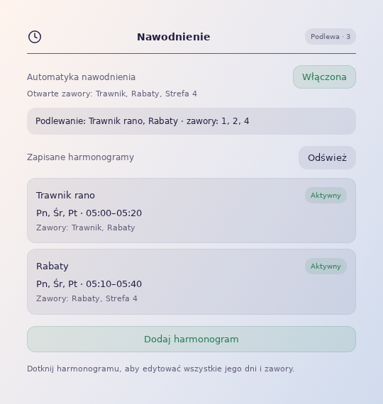

# Nawodnienie dla Home Assistant

Sterowanie zaworami za pomocą tygodniowych harmonogramów i karty dashboardu. Wszystko działa w Home Assistant, również przy zamkniętej aplikacji i dashboardzie. Node-RED nie jest potrzebny.

**Wersja:** 0.3.3 · **Home Assistant:** 2026.10.0 lub nowszy · **Języki:** polski, angielski, niemiecki

[English version](../README.md)



## Możliwości

- Dodawanie, nazywanie, edytowanie i usuwanie harmonogramów w karcie.
- Aktywowanie i dezaktywowanie harmonogramu bez usuwania jego dni, godzin i zaworów.
- Wybór dni tygodnia, godzin i zaworów dla każdego harmonogramu. Edycja zmienia cały harmonogram.
- Nakładające się harmonogramy mogą korzystać z tych samych zaworów. Zawór pozostaje otwarty, dopóki potrzebuje go choć jeden aktywny harmonogram.
- Obsługa przedziałów przechodzących przez północ.
- Przełącznik automatyki, ręczne sterowanie zaworami i bieżący status.
- Usunięty zawór jest jednorazowo zamykany, a następnie zwalniany spod kontroli integracji.
- Język interfejsu zgodny z Home Assistant. Twoje nazwy harmonogramów i zaworów pozostają bez zmian.

## Instalacja

[](https://my.home-assistant.io/redirect/hacs_repository/?owner=MojitoDevelop&repository=irrigation-integration&category=integration)

1. Otwórz **HACS**, wyszukaj **Irrigation** i pobierz integrację lub użyj przycisku powyżej.
2. Uruchom ponownie Home Assistant.
3. Wybierz **Ustawienia → Urządzenia i usługi → Dodaj integrację → Nawodnienie**.

Wskaż encje `switch` swoich zaworów i ustaw ich nazwy. Domyślnie żaden zawór nie jest wybrany. Listę możesz później zmienić w opcjach integracji.

<details>
<summary>Alternatywne metody instalacji</summary>

**Repozytorium niestandardowe (zapasowo):** jeśli Irrigation nie pojawia się w wyszukiwaniu HACS, dodaj `https://github.com/MojitoDevelop/irrigation-integration` jako repozytorium niestandardowe w kategorii **Integration** i pobierz integrację.

**Instalacja ręczna (awaryjnie):** pobierz i rozpakuj najnowsze [wydanie](https://github.com/MojitoDevelop/irrigation-integration/releases/latest), a następnie skopiuj `custom_components/irrigation_schedule` do `/config/custom_components/irrigation_schedule`.

Po obu metodach uruchom ponownie Home Assistant i dodaj integrację zgodnie z instrukcją powyżej.

</details>

## Karta dashboardu

```yaml
type: custom:irrigation-schedule-integration-card
```

Karta jest rejestrowana automatycznie. Kliknij **Dodaj harmonogram**, wpisz nazwę, wybierz dni, godziny i zawory, a następnie zapisz.

Włącz **Automatykę nawodnienia**, aby uruchamiać harmonogramy. Wyłączenie automatyki zamyka zawory. Po potwierdzeniu zamknięcia pojawią się przyciski sterowania ręcznego.

Listę zaworów możesz też podać w YAML karty. Przy wczytaniu karty przez administratora lista jest zapisywana w integracji:

```yaml
type: custom:irrigation-schedule-integration-card
valves:
  - entity: switch.garden_lawn
    name: Trawnik
  - entity: switch.garden_beds
    name: Rabaty
```

[Karta skoczka](../examples/navigation-card.yaml) korzysta z `custom:button-card`, pokazuje ikonę, nazwę i status oraz otwiera `/irrigation`. Wymaga zainstalowanego button-card.

## Encje i aktualizacje

| Domyślna encja | Działanie |
| --- | --- |
| `switch.irrigation_automation` | Włączenie i wyłączenie automatyki |
| `sensor.irrigation_status` | Aktualne działanie i błędy |

Harmonogramy korzystają z natywnych pomocników Schedule. Aktualizacja zachowuje istniejące identyfikatory encji i harmonogramy. Zaktualizuj integrację przez HACS, uruchom ponownie HA i otwórz ponownie dashboard. Integracja automatycznie aktualizuje swój zasób Lovelace. Wyłącz wcześniejszy sterownik tych samych zaworów.

[Instalacja i rozwiązywanie problemów](INSTALL.pl.md) · [Historia zmian](../CHANGELOG.md) · [Zgłoś problem](https://github.com/MojitoDevelop/irrigation-integration/issues) · [Licencja MIT](../LICENSE)
